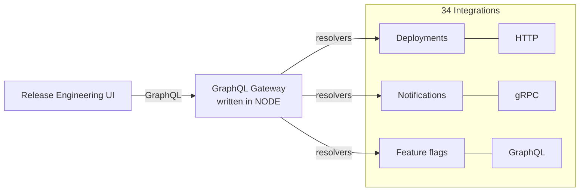
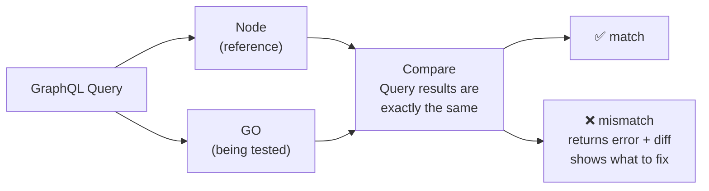
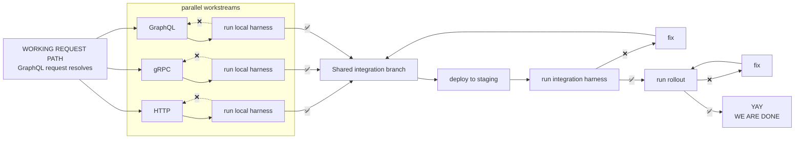

## The Problem

- **Most integrations are in GO**
- custom protocol plumbing
- custom auth
- maintenance burden

## Port vs. Rewrite

| Port | Rewrite |
|---|---|
| ✅ new language | ❌ changing language + behavior |
| ✅ architecture unchanged | ❌ hard to debug |

- Change one thing at a time
- Improvement comes later

## The Astounding Results!

- **FULL PARITY IN ONE WEEK!** AH-MAZING
- **SIZE:** ~10,000 lines of code (WOW)
- **COST:** $513.40 (Huzzah!!!)

## First: Comparison Harness

(one-shot PORT FAILED)

- **local harness:** mocked downstream services
- **integration harness:** real services + full path
- **rollout harness:** real services, full path, real production traffic

## Now do the thing! PORT

> **Agents do well with concrete failures**
