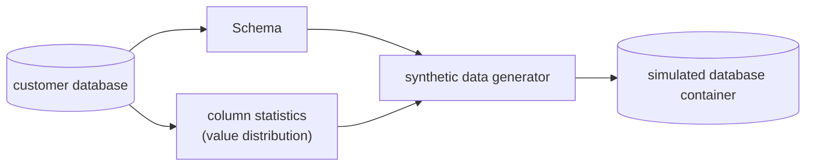
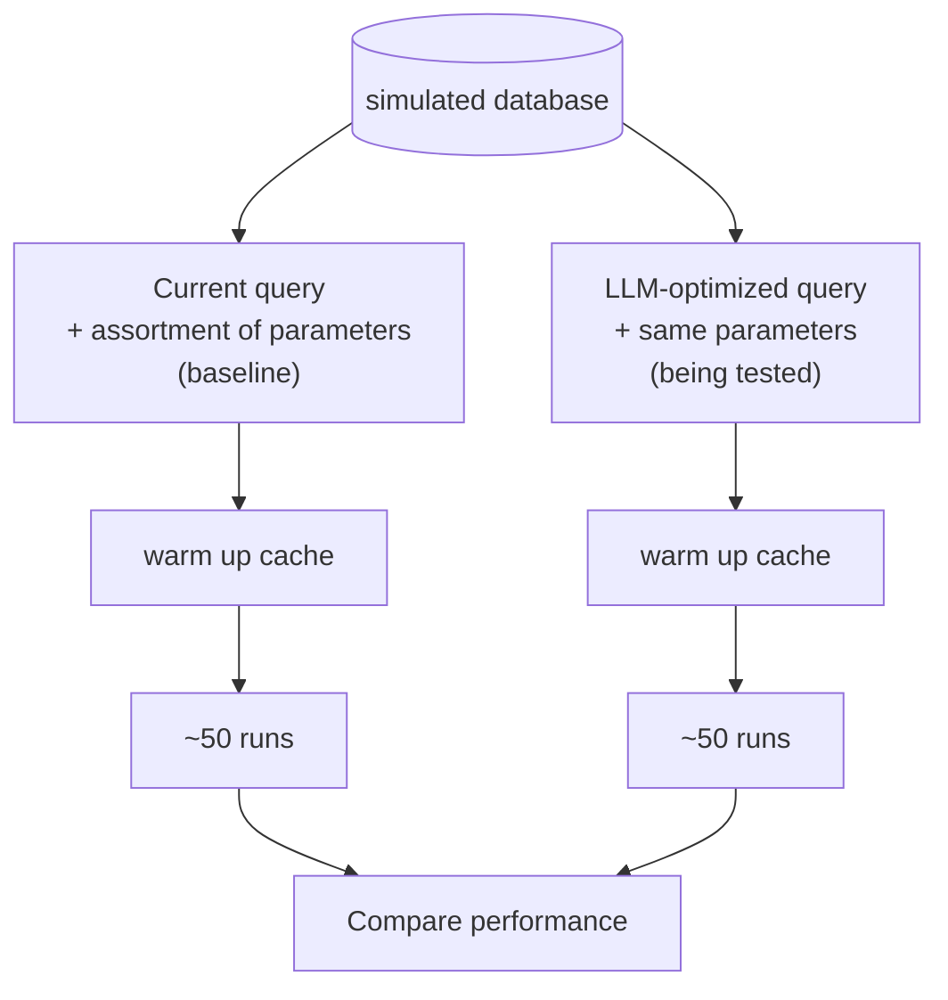

## Bits Database Optimization

- find slow database queries
- recommends optimizations

**Old approach = hand-code each optimization**

- examples: index optimizations
- problems: toil, doesn't scale, not many universal rules

**New approach = LLMs propose optimizations!**

- LLMs get execution plans, query metrics, schema, etc

### ? BUT CAN WE TRUST IT ?

**BENCHMARK THE LLM OPTIMIZATIONS BEFORE RECOMMENDING CHANGES**

Deterministic Validation Harness

---

## <ins>Build a Simulated Database</ins>

simulated database container: <ins>Production shaped</ins> but no customer data

---

## BENCHMARK

| measure: | calculate: | pass if: |
|---|---|---|
| logical reads | average | >20% improvement in at least 3 of 4 statistics |
| execution time | median | |
| dirtied blocks | p95 | |
| | max | |

---

## A typical week

| | |
|---|---|
| 3,000,000 | optimizable queries |
| 139,000 | concrete optimizations |
| 107,000 | passes prequisites |
| 29,000 | proven beneficial |

continuously running

---

## More selective over time

~75% pass rate → 33% pass rate

system tuned with customer feedback and dogfooding

---

## Benefits

- more optimization types
- months of hand-coding avoided
- positive customer feedback
- database regressions / performance issues automatically identified
